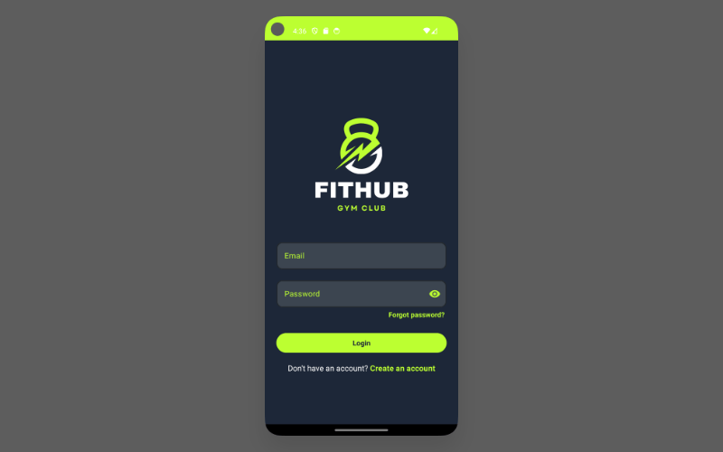

<p align="center">
  
</p>

<p align="center">
  
  
  
  
  
  
  
</p>

<p align="center">
  
  
  <a href="https://github.com/ellerbrock/open-source-badges/">
    
  </a>
</p>


## About FitHub

FitHub is a **mobile fitness community application** built with **expressive and modern Android technologies**.  
We believe that maintaining a healthy lifestyle should be **engaging, social, and accessible to everyone**.  
FitHub simplifies **fitness tracking** and **community interaction** by providing essential tools commonly needed  
in **fitness and wellness applications**, such as:

- **Secure login and registration** with **email verification** for enhanced security and user uniqueness.
- **Detailed nutritional information** for a wide variety of foods, with the ability to **select daily consumed items** and **visualize total daily calorie intake**.
- **Body Mass Index (BMI) visualization** based on the user’s **weight and height**.
- **Personalized workout selection**, including **specific and general workout programs**.
- **Community interaction** through **creating posts**, **liking**, **commenting**, and **sharing content**.
- **Real-time chatting** with members of the **fitness community**.
- **User profile management** with **editable personal information** and **application settings**.
- **Cloud-based data synchronization** using **Firebase Authentication, Database, and Storage services**.

FitHub is developed using **Java for Android** and follows the **MVVM architecture** to ensure **scalability**,  
**maintainability**, and **clean separation of concerns**, providing a **smooth and reliable user experience**.

<p align="center">
  
</p>

---

## ⚙️ Installation

### Prerequisites

- [Android Studio](https://developer.android.com/studio) (latest stable version recommended)
- **JDK 11** or higher (bundled with Android Studio)
- Android SDK **API 36** (compile) — the app runs on **Android 6.0 (API 23)** and above
- A Firebase project configured as described in [Firebase Setup](#-firebase-setup)

### Steps

1. **Clone the repository**

   ```bash
   git clone https://github.com/m-belefqih/FitHub.git
   cd FitHub
   ```

2. **Open the project in Android Studio**
   - **File → Open** and select the `FitHub` folder.

3. **Add the Firebase configuration file**
   - Copy your `google-services.json` into the `app/` folder.

4. **Sync Gradle**
   - Click **Sync Now** in the banner that appears, or
   - Go to **File → Sync Project with Gradle Files**.

5. **Run the application**
   - Select an emulator or connect a physical device (with **USB debugging** enabled).
   - Click **Run ▶** (or press `Shift + F10`).

6. **Create an account**
   - Register with a valid email address, then confirm it using the verification link before logging in.

---

## 🔥 Firebase Setup

> [!IMPORTANT]
> The original Firebase project was created in **test mode**, whose security rules expire automatically after **30 days**.
> Since then, the original backend no longer accepts requests, so **you need to connect the app to your own Firebase project** to run it.
> The `google-services.json` file is **not included** in this repository for security reasons.

### Firebase services used

| Service | Used for |
| ------- | -------- |
| **Authentication** (Email/Password) | Login, registration and email verification |
| **Cloud Firestore** | Users, posts, comments and nutrition data |
| **Realtime Database** | Real-time chat between members |

> [!NOTE]
> Images are hosted on **Google Drive** instead of Firebase Storage, so Cloud Storage is not required.

### Step 1 — Create a Firebase project

1. Open the [Firebase Console](https://console.firebase.google.com/) and sign in with your Google account.
2. Click **Create a project** (or **Add project**).
3. Enter a project name (e.g. `FitHub`) and follow the wizard.
   - Google Analytics is optional.

### Step 2 — Register the Android app

1. On the project overview page, click the **Android (🤖) icon**.
2. Fill in the form:

   | Field | Value |
   | ----- | ----- |
   | Android package name | `com.example.fithub` |
   | App nickname | `FitHub` |

   > ⚠️ The package name **must match exactly** `com.example.fithub`, otherwise the build will fail.

3. Click **Register app**.
4. Download the generated **`google-services.json`** file.
5. Move it into the `app/` folder of the project:

   ```text
   FitHub/
   ├── app/
   │   ├── google-services.json   ← here
   │   ├── build.gradle.kts
   │   └── src/
   ├── build.gradle.kts
   └── settings.gradle.kts
   ```

6. Skip the remaining SDK steps: the Firebase dependencies are already configured in `app/build.gradle.kts`.

### Step 3 — Enable the Firebase services

- **Authentication**
  1. Go to **Build → Authentication → Get started**.
  2. In the **Sign-in method** tab, enable **Email/Password**.
- **Cloud Firestore**
  1. Go to **Build → Firestore Database → Create database**.
  2. Choose a location close to your users.
  3. Start in **production mode** (rules are configured in Step 4).
- **Realtime Database**
  1. Go to **Build → Realtime Database → Create database**.
  2. Choose a location and start in **locked mode**.

### Step 4 — Configure security rules

To avoid the 30-day expiration of test mode, use rules that only allow **authenticated users**.

- **Firestore** → *Rules* tab:

  ```js
  rules_version = '2';
  service cloud.firestore {
    match /databases/{database}/documents {
      match /{document=**} {
        allow read, write: if request.auth != null;
      }
    }
  }
  ```

- **Realtime Database** → *Rules* tab:

  ```json
  {
    "rules": {
      ".read": "auth != null",
      ".write": "auth != null"
    }
  }
  ```

Click **Publish** after each change.

> [!TIP]
> These rules are a good starting point for development. For a public release, restrict access per collection (e.g. a user can only edit their own profile).

---

## MVVM Architecture


---


## 📸 Screenshots


---

## Team 

Project developed for the **Mobile Programming** module
University / School: Faculty of Science and Technology in Marrakech (FSTG)

Team members:

* BELEFQIH MOHAMMED
* EL MAHDAOUI MOHAMMED
* RIZKI ABDELHADI
* OUTZMOURTE HAMZA
* ID EL KADI AMINE
* EL IDRISSI MOHAMED

---

## Contributing

This project is currently under development and may contain bugs or incomplete features.
Contributions and improvements are welcome.
